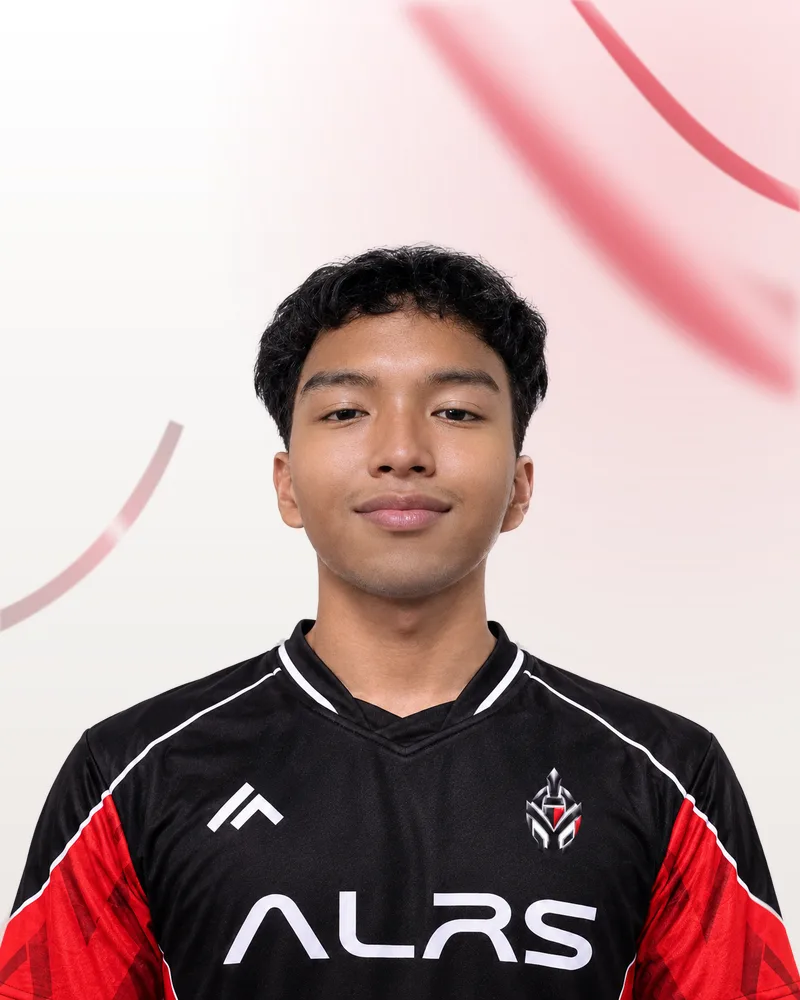

<p align="center">
  
</p>

<h1 align="center">ALRS Esports</h1>

<p align="center">
  <strong>Alangilan Red Spartans Esports</strong> · Valorant · Batangas City, Philippines
</p>

<p align="center">
  <a href="https://www.facebook.com/ALRS.Esports">Facebook</a>
</p>

---

## About

ALRS Esports is the esports organization of the Alangilan Red Spartans, based in Batangas City. Our Valorant team is **ALRS Dark Eros**.

This repo is the official ALRS Esports website, built and maintained by me. I also play on the team.

## Me on the roster



**heliokzin**: Duelist, ALRS Dark Eros

- **Game:** Valorant
- **Role:** Duelist (main roster)
- **Agents:** Neon, Phoenix

<br clear="right">

## ALRS Dark Eros

| Player        | Role                 |
| ------------- | -------------------- |
| john valorant | IGL / Initiator      |
| heliokzin     | Duelist              |
| Sipra         | Controller           |
| Drcy          | Flex                 |
| Empoleon      | Sentinel / Initiator |

**Subs:** z4ichi, jahi, kingke, sheepy (playing coach)

**Staff:** sheepy (Coach / Player), Yzak (Manager), Marl (Co-manager)

## The website

Static site built with [Astro](https://astro.build). Pages: Home, Roster, News, Partner, Contact.

The roster comes from [src/data/teams/valorant.ts](src/data/teams/valorant.ts). Site-wide settings live in [src/data/site.ts](src/data/site.ts).

```sh
npm install
npm run dev      # local dev server
npm run build    # static build to dist/
npm run preview  # preview the build
npm run assets   # rebuild logo and player images from assets-src/
```
